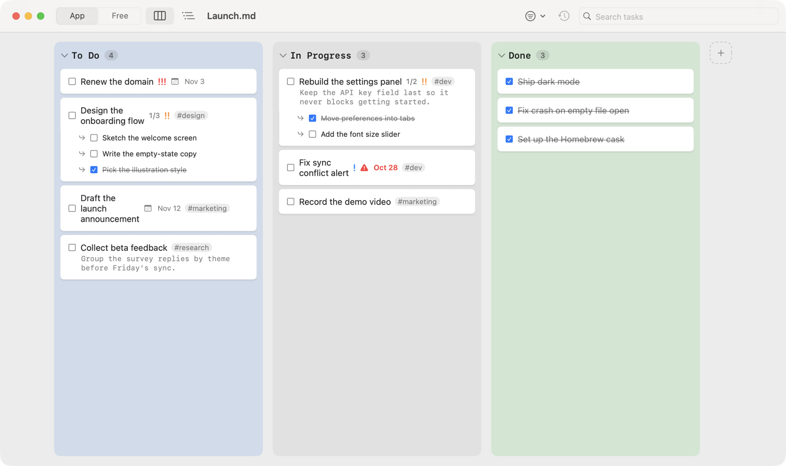
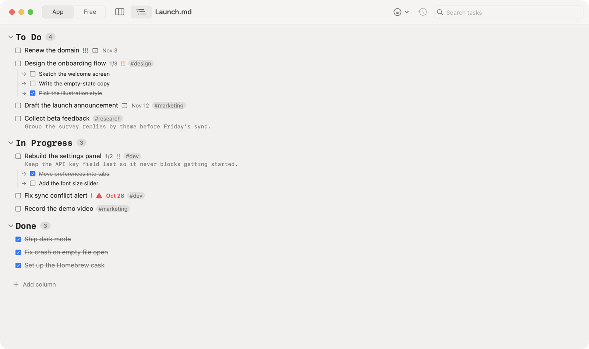
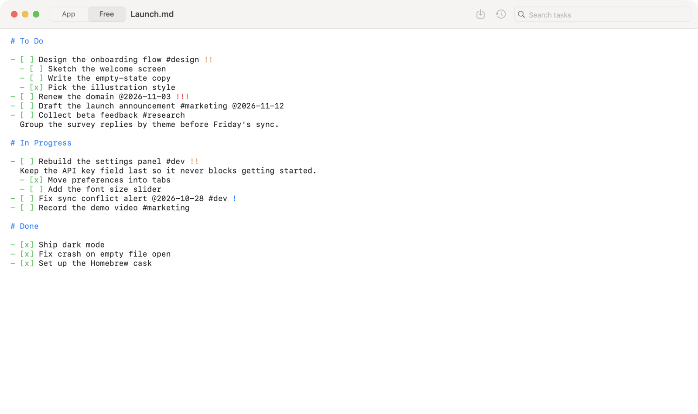
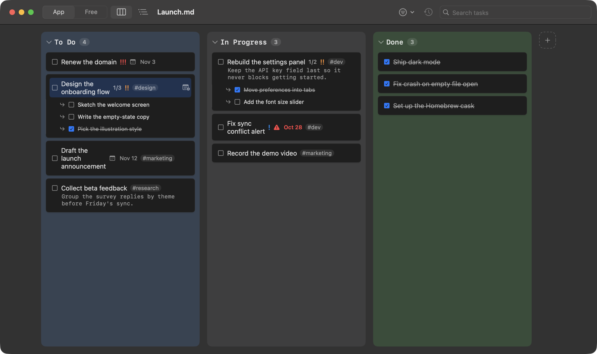

# Listo

A to-do list that lives as plain Markdown on disk. Kanban board, Outline
view, or the raw text itself — Listo keeps all three in sync with a single
`.md` file, no database or account involved. See the full spec in the
original artifact; this README maps the spec to the code. For design
decisions, bug write-ups, and other background on *why* the code looks the
way it does, see `CLAUDE.md`.

## Screenshots

| Kanban | Outline |
| --- | --- |
|  |  |

| Free Mode (raw Markdown) | Keyboard selection (dark) |
| --- | --- |
|  |  |

## Structure

```
Sources/ListoEngine/     UI-independent engine (Swift Package), spec §02/§05/§06
  Model.swift            File → Section → Task → Subtask tree + note,
                          task priority (`!`/`!!`/`!!!`, sorted for display)
                          (two levels: a Task may have a note, a Subtask
                          may not, and can't have subtasks of its own)
  Parser.swift           markdown → tree (2-space/tab indentation rule, §02)
  Serializer.swift       tree → markdown (used for new files and LLM merges)
  Editor.swift            Core of the App Mode editor: buffer, undo/redo
                          history, internals (§03/§05)
  Editor+Tasks.swift      add/toggle/rename/priority/note/insert
  Editor+Structure.swift  indent, outdent, reorder, split, group, move
                          (incl. drop-onto-task), delete
  TaskMetadata.swift      `@2026-11-03` due dates and `#tags` read from a
                          task's title
  TaskFilter.swift        Search/filter criteria + the filtered display order
  StableID.swift          Deterministic, content-derived UUID — a task's/
                          section's identity survives a reparse as long as
                          its content didn't change
  Differ.swift            Free Mode diff heuristic + ambiguity detection (§05)
  LogEvent.swift          Exact JSONL schema from §05
  LogWriter.swift         Log persistence + human-readable formatting
  LLMClient.swift         Interpreting ambiguous diffs + conflict merges (§03/§05)
  KeychainStore.swift     User's API key in the Keychain (§09 "bring your own LLM")

Sources/ListoApp/        SwiftUI app (macOS executable), ADR-001
  ListoApp.swift          @main, DocumentGroup (native tabs per document)
  ListoFileDocument.swift ReferenceFileDocument — raw text, round-trips
                          with SwiftUI; `onWillSave` triggers the Free Mode
                          diff
  DocumentController.swift Wires the engine to the UI: modes, diff on save,
                          log (+Selection, +DoneMove, +External extensions)
  TitleEditing.swift      Title-field flow shared by Kanban and Outline rows
  TaskDropTarget.swift    Drag a task onto another: reorder / nest (DropRule)
  TaskMetaViews.swift     Due/tag badges, Due date menu, toolbar filter menu
  ContentView.swift       Toolbar (App/Free Mode, Kanban/Outline, Save, history)
  KanbanView.swift        Board view (§04)
  OutlineBoardView.swift  Document view with real typographic hierarchy (§04)
  FreeEditView.swift      Wrapped NSTextView, syntax highlighting (ADR-001)
  PriorityIndicator.swift Priority badge + the context menu's Priority submenu
  SettingsView.swift      API key (§09) + language, theme, and font size
  LogPanelView.swift      Interpreted history + export (.jsonl or text)
  Localization.swift      AppSettings (language/theme/font size) + L(key, value)
  LocalizationTable.swift es/en translations in code, not a String Catalog
  RecentFilesStore.swift  Remembers opened files; reopens the last one on launch

Tests/ListoEngineTests/  137 tests covering the parser, editor, differ, metadata,
                         filter, drop and log
Tests/ListoAppTests/     42 tests covering DocumentController, DropRule and
                         external-change handling
Scripts/version.sh       Derives the version from git tags (no manual input)
Scripts/build_app.sh     Builds an ad-hoc-signed Listo.app into dist/ — no
                         tests, tagging, or publishing; just a local build
Scripts/publish_cask.sh  Runs build_app.sh, uploads the zipped result as
                         a GitHub release asset, tags + pushes the release,
                         then regenerates Casks/listo.rb in the tap — the
                         active distribution path (see "Installing" below)
```

### Versioning

No need to pick or track versions by hand: `Scripts/version.sh` derives one
from the repo's `vX.Y.Z` tags (the next patch after the latest tag, or the
exact tag if `HEAD` is already tagged — `0.1.0` if there isn't one yet).
`publish_cask.sh` uses it automatically when not given an explicit
version, and creates and pushes the tag once its release is out, so the
next run picks up from there on its own.

## Installing

```
brew tap sergiorivas/tap
brew trust --cask sergiorivas/tap/listo
brew install --cask listo
```

`brew trust` is required since this is a non-official (third-party) tap —
Homebrew won't load its casks otherwise.

Downloads a prebuilt, ad-hoc-signed `.app` from the latest GitHub release
(see `Casks/listo.rb` in the
[tap](https://github.com/sergiorivas/homebrew-tap)) straight into
`/Applications`, then strips the download's Gatekeeper quarantine flag
(`xattr -cr`). This is a Cask rather than a Formula because a Formula's
`install` step runs in a sandbox that can't write to `/Applications` —
only a Cask can place a `.app` there.

To publish a new version once changes are committed:

```
Scripts/publish_cask.sh
```

Runs the tests, builds and ad-hoc-signs the `.app`, zips it, tags and
pushes the release, uploads the zip as a GitHub release asset, and
regenerates/commits/pushes `Casks/listo.rb` in the tap. Defaults to a
`../homebrew-tap` checkout alongside this repo; override with
`LISTO_TAP_DIR=/path/to/your/homebrew-tap/checkout`. `LISTO_GITHUB_REPO`
(default `sergiorivas/listo`) overrides which repo the cask points at.

## Development

```
swift build              # builds engine + app
swift test                # runs the engine's tests
swift run ListoApp         # launches the app (unsigned; fine for local dev)
Scripts/build_app.sh      # builds a signed Listo.app into dist/
```

Note on `swift test`/`swift run` on Apple Silicon under a Rosetta shell: if
`xctest`/the binary fails on architecture, run `arch -arm64 swift test`.

## Splitting a task into its subtasks

With a task selected, **⌘T** (Task ▸ Split into tasks, or the context menu)
replaces it with one top-level task per subtask, named `Parent > Subtask`:
`Name A` with `S1` and `S2` becomes `Name A > S1` and `Name A > S2`. Each
keeps its subtask's done state and priority (an open one with none inherits
the parent's), the parent's note is copied onto each, and ⌘Z undoes it.

## Search, due dates and tags

⌘F searches task text and notes; the toolbar filter menu narrows by state,
minimum priority, due bucket and tag (clicking a `#tag` chip filters by it).
Write `@2026-11-03` and `#work` anywhere in a title: the board shows a date
badge (red when overdue) and tag chips in place of the raw tokens, and the
right-click menu has a Due date submenu. Filtering only hides rows; the file
is untouched.

## Drag and drop

Drag a task onto another: the top or bottom edge of the row reorders (a line
shows where), the middle nests it as that task's last subtask. Dropping on a
column or heading still moves it to the end of that section. Reordering
between different priorities isn't offered, since the board sorts by
priority.

## External changes

If the file is edited elsewhere while Listo is open it reloads when you come
back to the window, or asks first if you also have unsaved changes.

## User preferences

Besides the §07 defaults (system language, system appearance), Settings lets
you force a language (es/en/system) and theme (light/dark/system), plus a
base font size the rest of the sizes are relative to — adjustable there or
with ⌘+ / ⌘− / ⌘0 at any time, without relaunching the app. The app also
remembers the last file it had open (reopens it directly on launch instead
of a blank list) and offers "Open Recent" in the File menu, in addition to
macOS's own automatic recents. There is always at least one file open:
closing the last window opens the most recent other file (or a blank list if
there is none); quitting is unaffected.

## Known limitations

- By default `outdentTask` doesn't absorb the siblings that followed it as
  children — the task moves below its former parent. Turn on "When
  outdenting, following subtasks become its subtasks" in Settings for
  Workflowy-style behavior (single-task outdent only; a multi-selection
  outdent always uses the default).
- Ad-hoc signed, not notarized by Apple (see "Installing" above).
