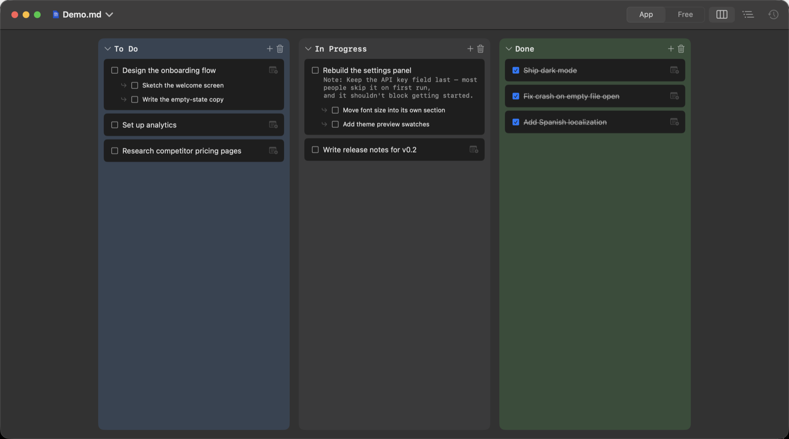
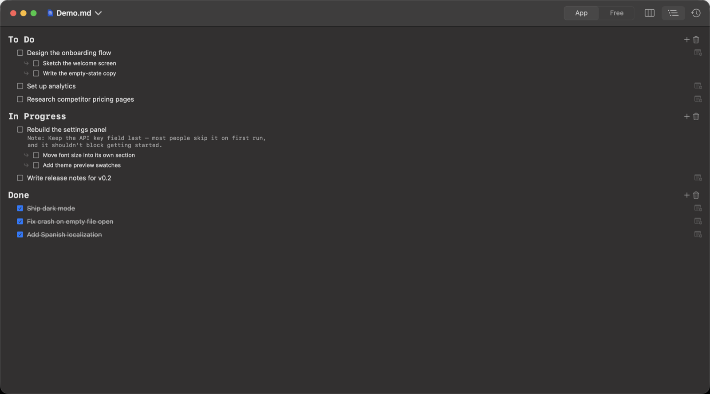
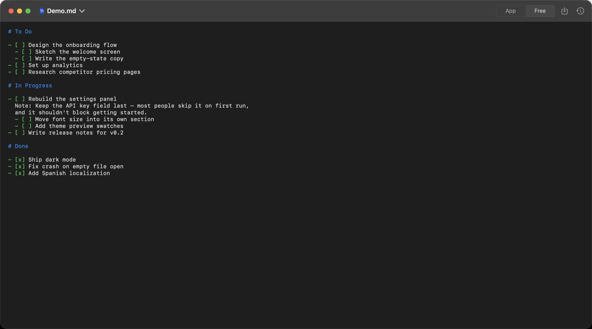
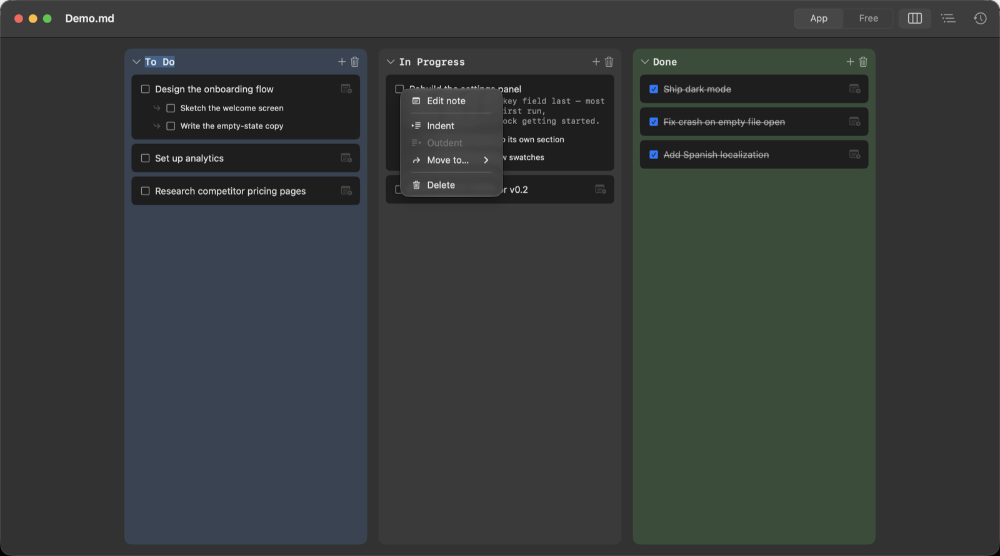

# Listo

A to-do list for macOS that lives as plain Markdown on disk. Kanban board,
Outline view, or the raw text itself: Listo keeps all three in sync with a
single `.md` file. There's no database and no account.

Website: [sergiorivas.github.io/listo](https://sergiorivas.github.io/listo/).
For design decisions, bug write-ups and other background on *why* the code
looks the way it does, see [`CLAUDE.md`](CLAUDE.md).

| Kanban | Outline |
| --- | --- |
|  |  |

| Free Mode (raw Markdown) | Right-click menu |
| --- | --- |
|  |  |

## Install

Requires **macOS 14 (Sonoma) or later**.

```
brew tap sergiorivas/tap
brew trust --cask sergiorivas/tap/listo
brew install --cask listo
```

`brew trust` is needed because this is a third-party tap: Homebrew won't load
its casks otherwise. The cask downloads a prebuilt `.app` from the latest
[GitHub release](https://github.com/sergiorivas/listo/releases/latest) into
`/Applications`.

### Opening it the first time

Listo is ad-hoc signed and **not notarized by Apple**, since notarizing needs
a paid Developer ID. The Homebrew cask already strips the download's
quarantine flag, so the app opens normally. If you downloaded the
`Listo-x.y.z.zip` from the releases page yourself, macOS will say the app
"can't be opened". Move it to `/Applications` and run this once:

```
xattr -cr /Applications/Listo.app
```

Or right-click the app ▸ **Open**, then confirm.

## The file format

A list is an ordinary Markdown file, and anything that edits text can edit
it. Listo reads it like this:

```markdown
# To Do                      ← a heading is a column (Kanban) / section (Outline)

- [ ] Design the onboarding flow !!     ← a task; `!!` = medium priority
  - [ ] Sketch the welcome screen       ← 2-space (or tab) indent = subtask
  - [x] Write the empty-state copy      ← `[x]` = done
- [ ] Renew passport @2026-12-01 #admin ← due date and tag
  Bring the old one and two photos.    ← indented plain text = the task's note

## Waiting                   ← a lower-level heading is a group inside the column

# Done
- [x] Ship dark mode
```

| Syntax | Meaning |
| --- | --- |
| `# Heading` | A column. `##`/`###` are groups nested inside it. |
| `- [ ] text` / `- [x] text` | An open / done task. |
| Two-space or tab indent under a task | A subtask (one level only). |
| Indented non-checkbox lines under a task | The task's note (subtasks have none). |
| `!`, `!!`, `!!!` at the end of a title | Low / medium / high priority. The board sorts by it and shows a badge. |
| `@YYYY-MM-DD` anywhere in a title | Due date, shown as a badge, red when overdue. |
| `#tag` anywhere in a title | Tag chip. Click it to filter by that tag. |

Listo never rewrites the file's order. Priority sorting happens only on
screen, and everything you type in Free Mode is kept verbatim.

## Using it

- **App Mode** (Kanban or Outline) edits the list through the UI. Every
  action saves immediately and can be undone (⌘Z).
- **Free Mode** is the raw text with syntax highlighting. It's interpreted
  when you save (⌘S, or by leaving Free Mode), and each change is written to
  a history log. Return on a task line starts a new `- [ ] `.
- **Quick add** (⌃⌥⌘T, from any app): a menu bar panel showing the first
  column's top three tasks, with a field to add one.
- **Search and filter** (⌘F, plus the toolbar filter menu): text, state,
  minimum priority, due date and tag. Filtering only hides rows; it never
  touches the file.
- **Drag and drop**: drop on the top or bottom edge of a task to reorder,
  on its middle to nest it as a subtask, or on a column to move it there.
- **External changes**: if another app edits the file while it's open,
  Listo reloads when you come back to the window. If you also have unsaved
  changes, it asks first.
- **Done column**: checking a task off moves it to the end of the first
  section named like "Done", "Completed", "Hecho" or "Terminado" after a
  short delay. You can set the names and the delay in Settings ▸ General.

### Keyboard shortcuts

| Keys | Action |
| --- | --- |
| ⌘N | New task in the first column |
| ↑ / ↓ | Select previous / next task |
| ⇧↑ / ⇧↓ | Extend the selection |
| Return | Edit the selected task; while editing, add the next one |
| Space | Check / uncheck |
| Delete | Delete (Backspace on an empty task removes it) |
| ⇥ / ⇧⇥ (or ⌘] / ⌘[) | Indent / outdent |
| ⌘↑ / ⌘↓ | Reorder within the same priority |
| ⌘← / ⌘→ | Move to the previous / next column (Kanban) |
| ⌥⌘1 / ⌥⌘2 / ⌥⌘3 / ⌥⌘0 | Priority low / medium / high / none |
| ⌘T | Split a task into one task per subtask |
| ⌘G | Group the selected tasks into one |
| ⌘Z / ⇧⌘Z | Undo / redo |
| ⌘F | Search |
| ⌘1 / ⌘2 / ⌘3 | Kanban / Outline / Free Mode |
| ⌘+ / ⌘− / ⌘0 | Font size |
| ⌃⌥⌘T | Quick add from anywhere (configurable) |
| Esc | Clear the selection |

**Split (⌘T)** turns `Name A` with subtasks `S1` and `S2` into `Name A > S1`
and `Name A > S2`. Each new task keeps its subtask's done state and priority
(an open one with no priority of its own inherits the parent's), and the
parent's note is copied onto each. **Group (⌘G)** does the reverse, naming
the group after the tasks' longest common prefix.

### Settings

- **General**: language (English / Spanish / system), completion and delete
  sounds, outdent behaviour, and the Done column move (delay and names).
- **Appearance**: theme, base font size (all other sizes are relative to
  it), long Kanban titles (truncate / wrap), first/last column tint.
- **Shortcuts**: the global quick-add shortcut, plus a reference list of the
  board's shortcuts.
- **Assistant** (optional): an Anthropic or OpenRouter API key, stored in
  the macOS Keychain, with a **Test connection** button. It's used only to
  interpret ambiguous Free Mode edits for the log. Without a key those edits
  are logged as "unresolved". Nothing else changes.

When there's no file open, Listo asks you to choose one: a recent file, an
existing file, or a new list. On launch it reopens the last file you had
open.

### Known limitations

- By default, outdenting a subtask moves it below its former parent. Turn on
  "When outdenting, following subtasks become its subtasks" in Settings for
  Workflowy-style behaviour (single-task outdent only; a multi-selection
  outdent always uses the default).
- Pure reorders, splits and groups done by hand in Free Mode are logged as
  deletes plus creates, not as those actions.
- Not notarized by Apple (see [Opening it the first time](#opening-it-the-first-time)).

## Development

```
swift build                # builds engine + app
swift test                 # runs engine and app tests
swift run ListoApp         # launches the app (unsigned; fine for local dev)
Scripts/build_app.sh       # builds an ad-hoc-signed Listo.app into dist/
```

On Apple Silicon under a Rosetta shell, if `xctest` or the binary fails on
architecture, run `arch -arm64 swift test`.

### Releasing

```
Scripts/publish_cask.sh
```

This runs the tests, builds and ad-hoc-signs the `.app`, zips it, tags and
pushes the release, uploads the zip as a GitHub release asset, and
regenerates/commits/pushes `Casks/listo.rb` in the tap. It expects a
`../homebrew-tap` checkout next to this repo; override that with
`LISTO_TAP_DIR=/path/to/homebrew-tap`. `LISTO_GITHUB_REPO` (default
`sergiorivas/listo`) sets which repo the cask points at.

Distribution is a Cask rather than a Formula because a Formula's `install`
step runs in a sandbox that can't write to `/Applications`.

**Versioning** is automatic. `Scripts/version.sh` derives the version from
the repo's `vX.Y.Z` tags: the next patch after the latest tag, the exact tag
if `HEAD` is already tagged, or `0.1.0` if there are no tags yet.
`publish_cask.sh` creates and pushes the tag once the release is out.

### Source layout

```
Sources/ListoEngine/      UI-independent engine (no SwiftUI)
  Model.swift             File → Section → Task → Subtask tree + note, priority
  Parser.swift            markdown → tree (2-space/tab indentation rule)
  Serializer.swift        tree → markdown
  Editor.swift            App Mode editor core: buffer, undo/redo history
  Editor+Tasks.swift      add / toggle / rename / priority / note / insert
  Editor+Structure.swift  indent, outdent, reorder, split, group, move, delete
  TaskMetadata.swift      `@2026-11-03` due dates and `#tags` read from a title
  TaskFilter.swift        Search/filter criteria + filtered display order
  StableID.swift          Deterministic, content-derived ids across reparses
  Differ.swift            Free Mode diff heuristic + ambiguity detection
  LogEvent.swift          JSONL log schema
  LogWriter.swift         Log persistence + human-readable formatting
  LLMClient.swift         Anthropic / OpenRouter clients (diffs, merges, key test)
  KeychainStore.swift     The user's API key in the Keychain

Sources/ListoApp/         SwiftUI macOS app
  ListoApp.swift          @main, DocumentGroup, menus (Task, View, Undo), launch flow
  ListoFileDocument.swift ReferenceFileDocument; `onWillSave` triggers the Free Mode diff
  DocumentController*.swift  Engine ↔ UI: modes, actions, undo banner, selection,
                          Done move, external changes
  ContentView.swift       Window: toolbar, mode/view switch, undo banner
  KanbanView.swift        Board view
  OutlineBoardView.swift  Document view with typographic hierarchy
  FreeEditView.swift      NSTextView with syntax highlighting
  TaskRowParts.swift      Row pieces shared by Kanban and Outline
  TitleEditing.swift      Title-field flow (commit / cancel / Return / Tab / ↑↓)
  SectionButtons.swift    Section add/delete buttons, title field, add column
  SectionCountBadge.swift Task-count badge on headers
  TaskDropTarget.swift    Drag onto a task: reorder / nest (+ DropRule.swift)
  TaskMetaViews.swift     Due/tag badges, Due date menu, toolbar filter menu
  FilterBar.swift         Active-filter chips + "N of M tasks"
  PriorityIndicator.swift Priority badge + the Priority submenu
  NoteEditor.swift        Note popover
  Motion.swift            Shared animations (all respect Reduce Motion)
  QuickAdd.swift          Menu bar icon + global quick-add panel
  HotKeyShortcut.swift    Carbon hot key + shortcut recorder
  SettingsView.swift      Tabbed Settings (General / Appearance / Shortcuts / Assistant)
  LogPanelView.swift      Interpreted history + export (.jsonl or text)
  Localization.swift      AppSettings + L(key, value)
  LocalizationTable.swift es/en strings in code (no String Catalog under SwiftPM)
  KanbanLayoutStore.swift / OutlineLayoutStore.swift  Column widths, folded sections
  RecentFilesStore.swift  Recent files; reopens the last one on launch
  WelcomeView.swift       First-launch welcome (also Help ▸ Welcome to Listo)
  SoundPlayer.swift, TaskLineContinuation.swift, ExternalChange.swift, …

Tests/ListoEngineTests/   Parser, editor, differ, metadata, filter, drop, log, undo
Tests/ListoAppTests/      DocumentController, DropRule, external changes, hot keys
Scripts/                  version.sh, build_app.sh, publish_cask.sh
docs/                     Landing page (index.html) + screenshots
```
